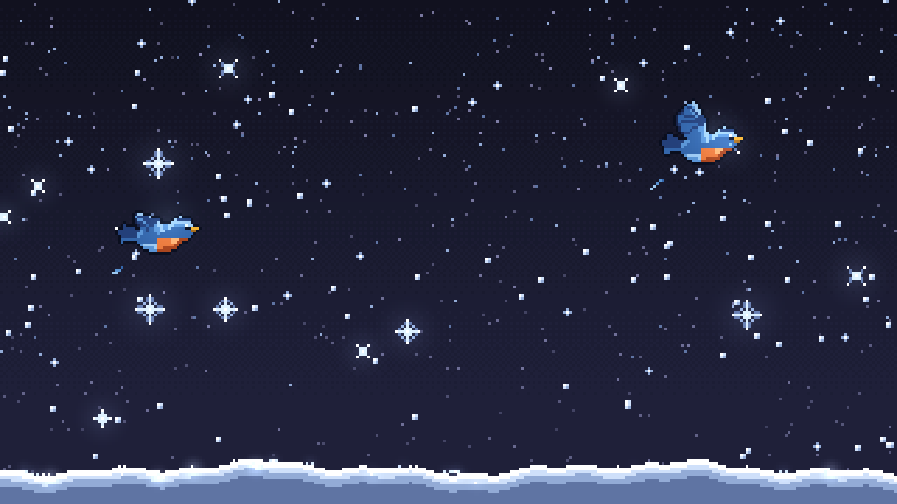
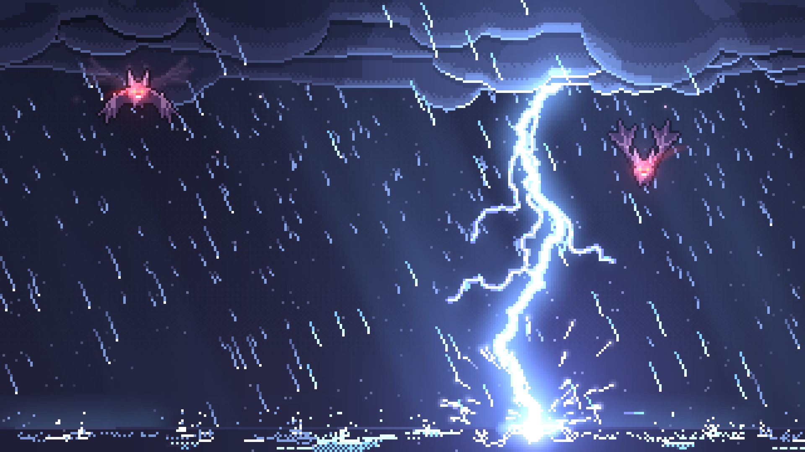
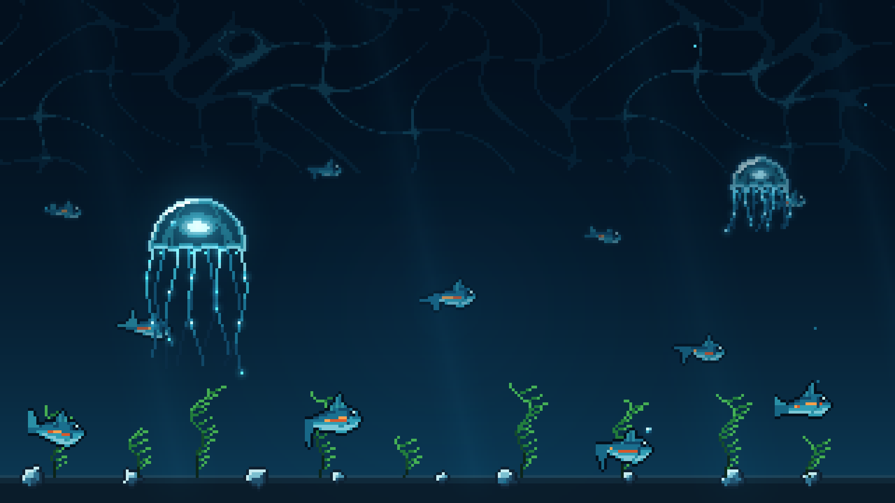
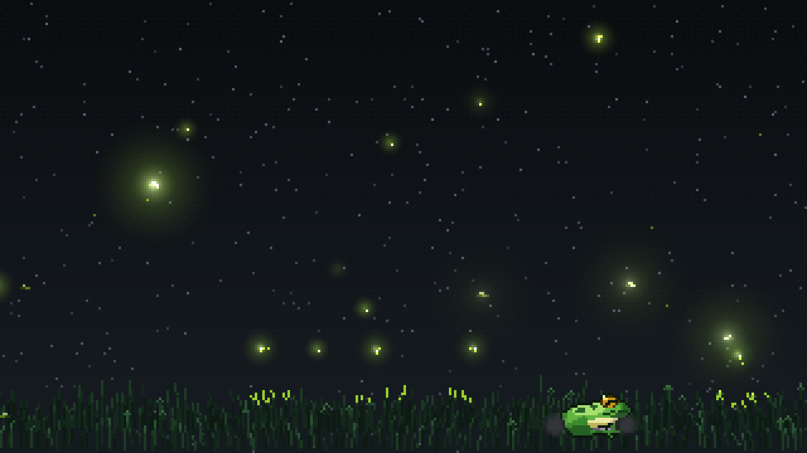

<div align="center">

[**简体中文**](README.md) | English

# Pixel Fantasia · 像素幻境

**Lightweight pixel-art live wallpapers · One-click recolor · Desktop pets · Open container**

[](LICENSE)
[](https://github.com/chenchunlong-ai/pixel-fantasia/releases)
[](https://github.com/chenchunlong-ai/pixel-fantasia/releases)

</div>

---

**Pixel Fantasia** is a **fully offline** Windows live-wallpaper app: 23 procedural pixel
scenes drawn in real time by code, 27 palettes that recolor the whole scene in one click,
11 pixel critters living inside your wallpaper — and an **open container**: anyone can load
their own single-file HTML wallpapers (2D / 3D / WebGL / video) and transparent pet files,
or have an AI generate them with the
[authoring spec](palette-wallpaper/skill/SKILL.md).

| | |
|---|---|
|  |  |
|  |  |
|  | |

## ✨ Features

- 🎨 **23 procedural scenes** — snow, rain, storms, aurora, fireflies, black holes, a dimensional rift, waterfall valley, fire tornado and more. No videos, no downloads, seamless loops.
- 🌈 **One-click recolor** — 27 palettes swap the whole scene in an instant: snowfield becomes lava, grassland becomes toxic.
- 🐾 **Desktop pets** — 11 built-in critters (ghost, bat, butterfly, frog…); load your own pet files; position, scale and rotation are remembered per wallpaper.
- 📦 **Open container** — drag-and-drop single-file HTML wallpapers/pets, sandboxed with a CSP that blocks all network access.
- ⚡ **Tiny & offline** — installer under 1 MB, zero network permissions, collects no data ([privacy policy](https://chenchunlong-ai.github.io/pixel-fantasia/privacy.html)).
- 🌍 **9 languages** · lock screen · autostart · auto-cycle · pause hotkey.

## 📥 Install

**Microsoft Store** (recommended): search “Pixel Fantasia” / 「像素幻境」or visit the
[Store page](https://apps.microsoft.com/detail/9NZV5LCNMW9F).

**Direct download**: grab `PixelPalette-Setup.exe` from
[Releases](https://github.com/chenchunlong-ai/pixel-fantasia/releases) (includes WebView2 detection).

> Uninstall: in-app About menu → Uninstall, or Windows Settings → Apps.

## 🛠️ Build from source

Requirements: Windows 10/11, Node.js (for the build scripts), WebView2 runtime (for testing).
The C# shell compiles with the system `csc.exe` — **no Visual Studio, no NuGet**.

```bash
node palette-wallpaper/build.mjs    # produces exe / installer / MSIX
node palette-wallpaper/verify.mjs   # scene verification
```

Preview scenes in a browser (the engine imports by relative path):

```
npx http-server -p 8080 -c-1
# open http://127.0.0.1:8080/palette-wallpaper/src/runtime.html?fx=weather/snow&palette=ice&bg=black
```

Full architecture and development guide: [`palette-wallpaper/skill/PROJECT.md`](palette-wallpaper/skill/PROJECT.md).

## 🖌️ Make your own wallpapers / pets

Feed [`palette-wallpaper/skill/SKILL.md`](palette-wallpaper/skill/SKILL.md) to any AI
(or write it yourself) and drop the resulting self-contained HTML file into the app:
2D pixel scenes, 3D WebGL scenes (example
[aurora-valley-3d.html](palette-wallpaper/skill/examples/aurora-valley-3d.html)),
transparent pets (example [snow-fox.html](palette-wallpaper/skill/examples/snow-fox.html)).

## 🤝 Contributing

Issues and PRs welcome! See [CONTRIBUTING.md](CONTRIBUTING.md).

## 💖 Support the developer

If you like the app, a small tip keeps development going — completely voluntary,
unlocks nothing. *(Donation links pending.)*

## 📄 License

[MIT](LICENSE) — engine portions Copyright (c) 2026 Patch; some effects adapt
Hugo Duprez's open-source assets; see [NOTICE.md](NOTICE.md) for third-party notices.
