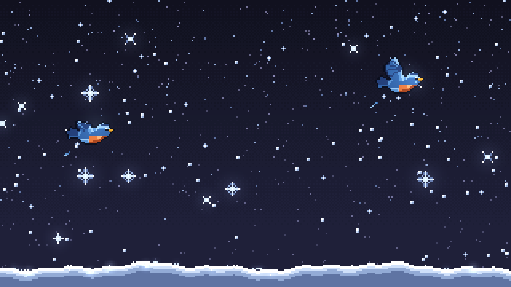
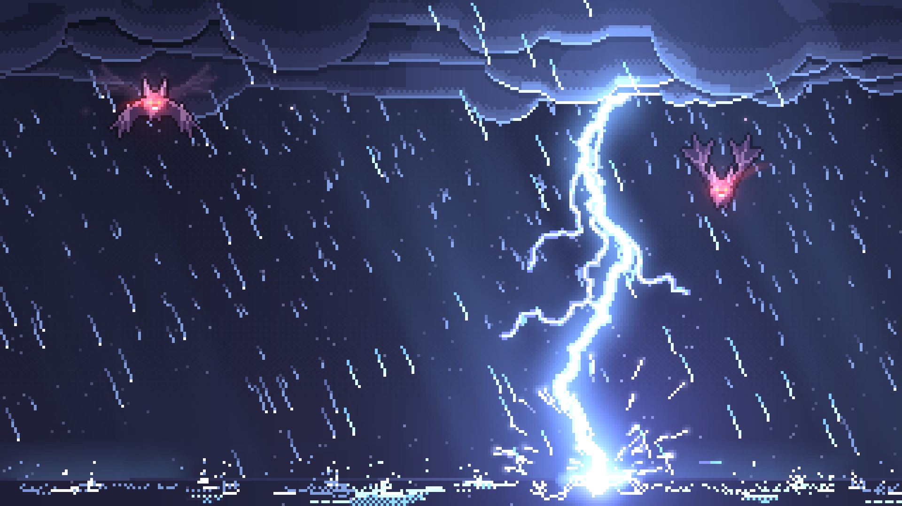
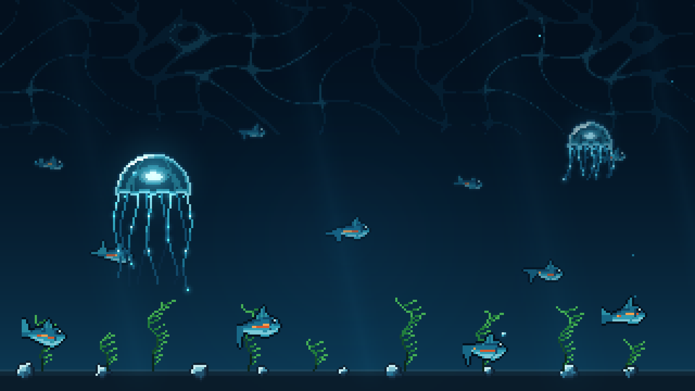
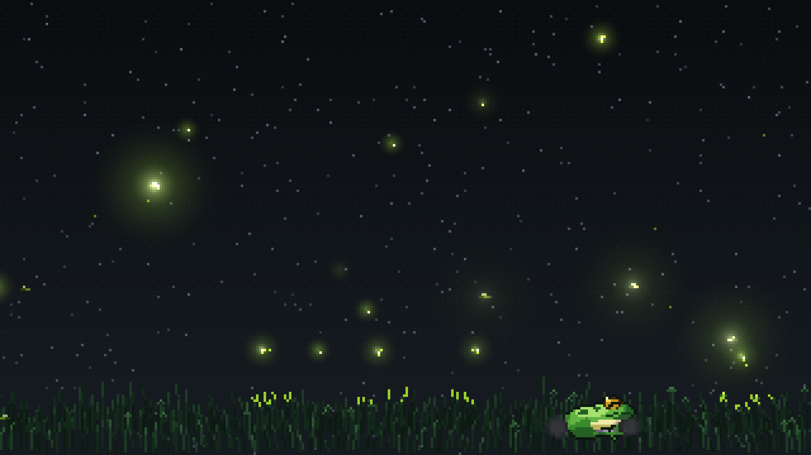
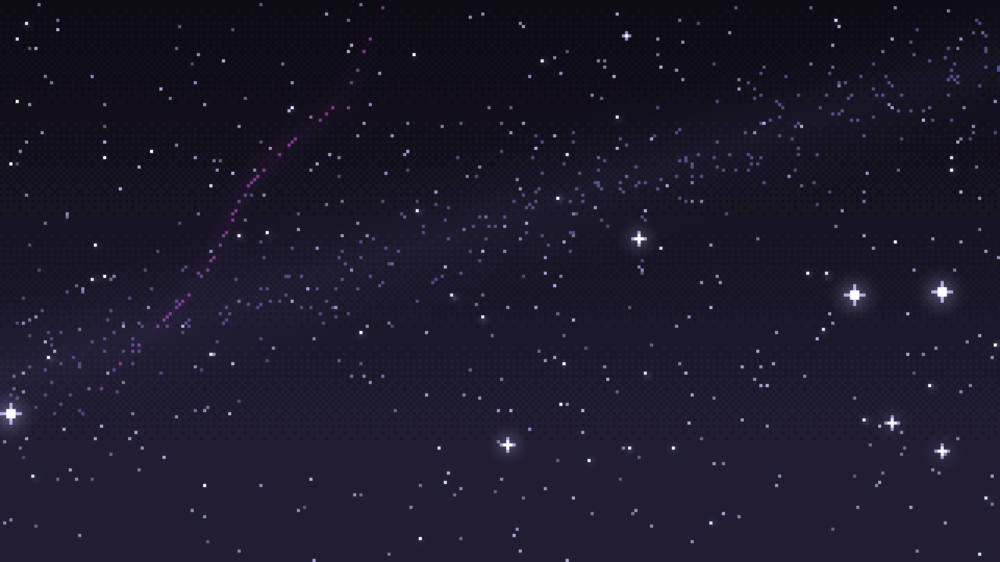

<div align="center">

简体中文 | [**English**](README.en.md)

# 像素幻境 · Pixel Fantasia

**轻量像素动态壁纸 · 一键换色 · 可装自制壁纸和桌宠**

*Lightweight pixel-art live wallpapers · one-click recolor · desktop pets · open container*

[](LICENSE)
[](https://github.com/chenchunlong-ai/pixel-fantasia/releases)
[](https://github.com/chenchunlong-ai/pixel-fantasia/releases)

</div>

---

「像素幻境」是一款**完全离线**的 Windows 动态壁纸软件：21 个程序化像素场景由代码实时绘制，
27 套调色板一键换色，11 只像素小生物住在壁纸里；同时它是一个**开放的壁纸容器**——
任何人都可以加载自己（或让 AI 按 [`skill/SKILL.md`](palette-wallpaper/skill/SKILL.md) 范式生成）的
单文件 HTML 壁纸（2D / 3D / WebGL / 视频）与透明宠物文件。

A fully offline Windows live-wallpaper app: 21 procedural pixel scenes drawn in real time,
27 palettes with one-click recolor, 11 built-in desktop pets — and an open container that
loads any single-file HTML wallpaper (2D / 3D / WebGL / video) or transparent pet file.

| | |
|---|---|
|  |  |
|  |  |
|  | |

## ✨ 特性

- 🎨 **21 个程序化场景** — 雪、雨、雷暴、极光、萤火虫、黑洞、时空裂缝、瀑布谷、火焰龙卷风……全部代码实时绘制，无视频、无下载、无缝循环
- 🌈 **一键换装** — 27 套调色板瞬间整套替换：雪原变熔岩、草原变剧毒
- 🐾 **桌面宠物** — 幽灵、蝙蝠、蝴蝶、青蛙等 11 只内置小生物，可加载自制宠物文件，位置/大小/旋转按壁纸记忆
- 📦 **开放容器** — 单文件 HTML 壁纸/宠物即拖即用，CSP 沙箱禁网，安全隔离
- ⚡ **超轻离线** — 安装包 <1 MB，零网络权限，不收集任何数据（[隐私政策](https://chenchunlong-ai.github.io/pixel-fantasia/privacy.html)）
- 🌍 **9 国语言** · 锁屏壁纸 · 开机自启 · 自动轮播 · 暂停快捷键

## 📥 安装

**Microsoft Store**（推荐）：搜索「像素幻境」或 [Store 页面](https://apps.microsoft.com/detail/9NZV5LCNMW9F)。

**直装**：到 [Releases](https://github.com/chenchunlong-ai/pixel-fantasia/releases) 下载
`PixelPalette-Setup.exe`（自带 WebView2 检测）。

> 卸载：设置 → 关于 → 卸载，或 Windows"设置 → 应用"。

## 🛠️ 从源码构建

环境要求：Windows 10/11、Node.js（仅构建脚本用）、已装 WebView2 运行时（测试需要）。
C# 外壳用系统自带 `csc.exe` 编译，**无需 Visual Studio、无需 NuGet**。

```bash
node palette-wallpaper/build.mjs    # 产出 exe / 安装器 / MSIX
node palette-wallpaper/verify.mjs   # 场景验证
```

浏览器预览场景（引擎按相对路径 import）：

```
npx http-server -p 8080 -c-1
# 打开 http://127.0.0.1:8080/palette-wallpaper/src/runtime.html?fx=weather/snow&palette=ice&bg=black
```

详细架构与开发指南见 [`palette-wallpaper/skill/PROJECT.md`](palette-wallpaper/skill/PROJECT.md)。

## 🖌️ 制作你自己的壁纸 / 宠物

把 [`palette-wallpaper/skill/SKILL.md`](palette-wallpaper/skill/SKILL.md) 喂给任何 AI
（或照着写），产出一个自包含 HTML 文件，拖进软件即可：
2D 像素场景、3D WebGL 场景（范例 [aurora-valley-3d.html](palette-wallpaper/skill/examples/aurora-valley-3d.html)）、
透明宠物（范例 [snow-fox.html](palette-wallpaper/skill/examples/snow-fox.html)）。

## 🤝 参与贡献

欢迎 Issue 与 PR！见 [CONTRIBUTING.md](CONTRIBUTING.md)。

## 📄 许可

[GPL-3.0](LICENSE) — 引擎部分 Copyright (c) 2026 Patch，部分特效改编自 Hugo Duprez 的开源素材，
第三方声明见 [NOTICE.md](NOTICE.md)。
